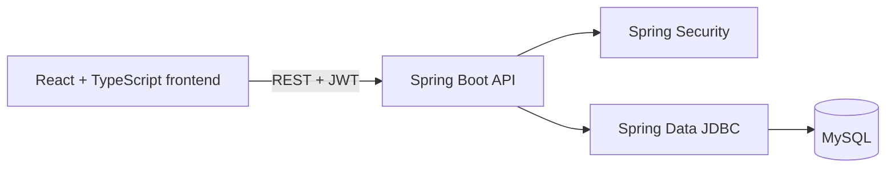

# Interactive Learning Platform

A full-stack language-learning application with a React frontend and a Spring Boot REST API. Users can register, authenticate, browse language courses, study lessons, track completion and progress, and take quizzes.

## Features

- User registration and JWT-based login
- Course and lesson browsing
- Lesson selection and completion tracking
- Progress and learning-streak tracking
- Quizzes and quiz results
- Responsive React interface

## Technology

- Frontend: React 19, TypeScript, Material UI 6, Axios, React Router
- Backend: Java 21, Spring Boot 4, Spring Security, Spring Data JDBC, MySQL, Maven

## Project Structure

```text
Interactive-Learning-Platform/
├── frontend/ilp-web/       # React application
├── language-flow-backend/   # Spring Boot REST API
├── src/                     # Legacy desktop-project sources
└── README.md
```

The active web application uses `frontend/ilp-web` and `language-flow-backend`.

## Prerequisites

- JDK 21 or newer
- Maven 3.9 or newer
- Node.js and npm
- MySQL 8 or compatible MySQL server

## Database Setup

Create a MySQL database named `learning_platform`. The local-development defaults are:

```text
Host: localhost
Port: 3306
Database: learning_platform
Username: root
Password: 0000
```

For shared or production environments, override credentials with environment variables:

```powershell
$env:SPRING_DATASOURCE_URL = "jdbc:mysql://localhost:3306/learning_platform?useSSL=false&serverTimezone=UTC&allowPublicKeyRetrieval=true"
$env:SPRING_DATASOURCE_USERNAME = "root"
$env:SPRING_DATASOURCE_PASSWORD = "your-password"
$env:JWT_SECRET = "replace-with-a-long-random-secret"
```

Never use local credentials or the development JWT secret in production.

## Run the Backend

```powershell
cd language-flow-backend
mvn.cmd spring-boot:run
```

The API runs at `http://localhost:8080`.

## Run the Frontend

```powershell
cd frontend/ilp-web
npm install
npm start
```

The frontend normally runs at `http://localhost:3000`. If that port is unavailable, Create React App may use another port, such as `http://localhost:3001`.

The default API URL is `http://localhost:8080/api/v1`. To override it, create `frontend/ilp-web/.env.local`:

```text
REACT_APP_API_URL=http://localhost:8080/api/v1
```

Restart the frontend after changing environment variables.

## API Areas

| Area | Base path | Purpose |
|---|---|---|
| Authentication | `/api/v1/auth` | Registration and login |
| Courses | `/api/v1/courses` | Course browsing and management |
| Lessons | `/api/v1/lessons` | Lesson retrieval and completion |
| Quizzes | `/api/v1/quizzes` | Quiz questions and results |
| Users | `/api/v1/users` | User profile and progress |

Authentication endpoints are public. Other `/api/v1/**` endpoints require a JWT bearer token.

## Development Notes

- Start MySQL before starting the backend.
- Start the backend before using registration, login, or other API-backed pages.
- If the frontend uses port 3001, ensure that port is included in the backend CORS configuration.

## Architecture



## License

This project is for educational purposes.
